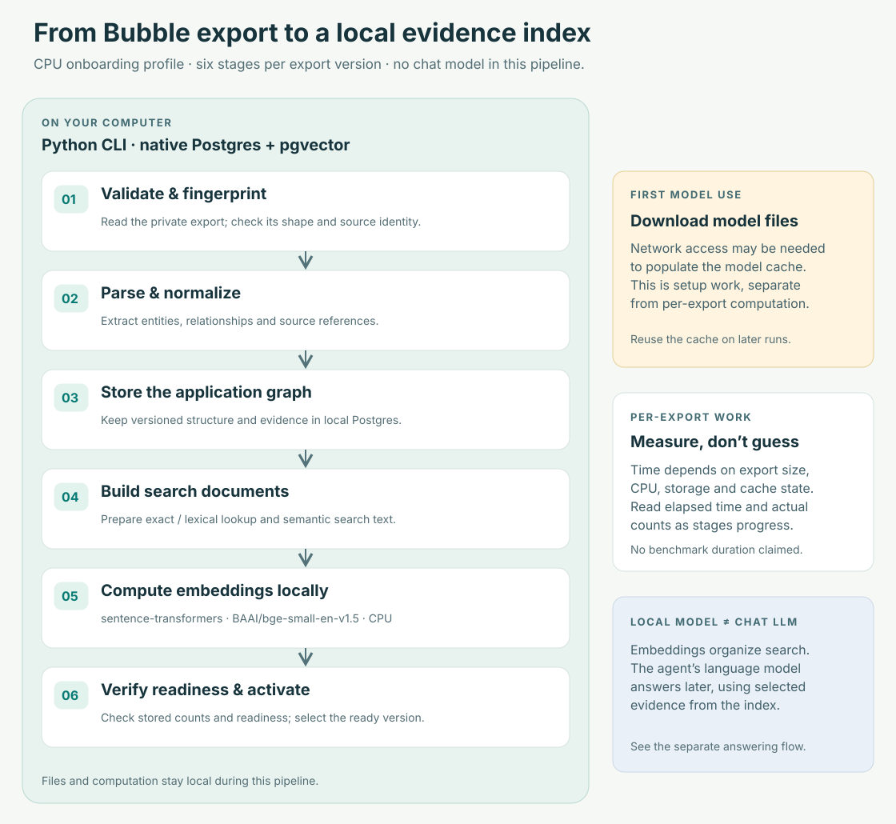
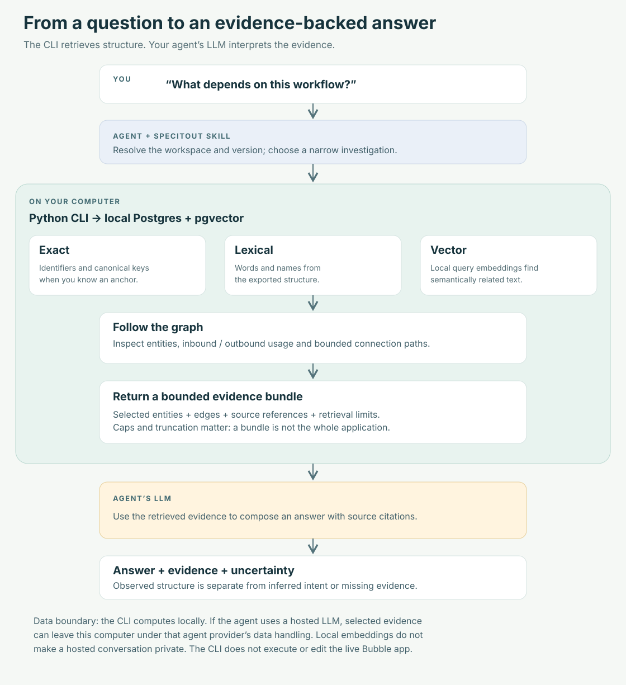

# SpecItOut CLI

Understand a Bubble application through its export. SpecItOut turns a private
export into searchable entities, relationships and source evidence so your coding
agent can investigate dependencies and explain what the exported app contains.

Use it when you are taking over an unfamiliar app, tracing a workflow, assessing
a proposed change, or preparing a migration. The CLI retrieves evidence; your
agent’s LLM writes the answer.

## Start with your agent

Give your coding agent this repository URL and paste:

> Install SpecItOut and its analysis skill from this repository. Set up a private
> workspace for my Bubble application, then ask me for the local export path.
> Process the export with progress updates and verify readiness before answering
> questions about it.

The agent follows the [setup guide](docs/agent-setup.md), installs the CLI and
bundled skill from the same Git revision, and creates a separate private folder
for your app. Git is not required in that folder. One CLI installation can serve
several workspaces.

**Version:** 0.2.2. Install from an explicit repository commit using the setup
guide; a package-index release is not assumed.
The initial native-runtime target is macOS or Linux as a non-root user, with
Python 3.11+, Postgres, pgvector and sentence-transformers. Native Windows,
Docker and hosted databases are outside this onboarding path. See the setup
guide for prerequisites and validation limits.

## Prepare the export locally



The Python CLI parses the export, stores a versioned application graph in local
Postgres, builds search documents, and computes local embeddings with
sentence-transformers and `BAAI/bge-small-en-v1.5`. The diagram shows a CPU
onboarding profile; the provider otherwise selects its device automatically.
An initial model download is separate from work on each export. Processing time
is unbenchmarked: use measured elapsed time and counts, not a promised duration.

[Processing stages, storage and limitations →](docs/architecture.md)

## Ask questions with evidence



This is **retrieval-augmented generation (RAG)**: the CLI retrieves evidence,
then the agent generates an answer grounded in that evidence.

Exact identifiers, lexical matches and vector similarity help find an anchor.
Graph traversal then exposes connected entities. A bounded bundle gives the
agent relevant evidence and explicit limits without loading the entire export
into the conversation. The CLI computes locally; **a hosted agent’s LLM can
receive retrieved application evidence** under that agent provider’s data
handling.

Try questions such as:

- “Where is this field referenced, and which connected actions may write it?”
- “What uses this workflow, and what does it depend on?”
- “Which pages are connected to this reusable element?”
- “What paths connect these two entities?”
- “Collect the evidence relevant to moving this workflow out of Bubble.”

These questions map to search, entity lookup, usage, paths and context bundles.
The answer depends on what the parser extracted and what the selected version
contains. Business intent, runtime execution and behavior missing from the
export require additional evidence.

An answer should look like this **synthetic illustration**, not a claim about a
real application or a literal CLI response:

> **Observed:** `approve_order` references `Order.status` through action
> `set_status`. [1]
>
> **Interpretation:** This may be part of order approval. The export alone does
> not establish the business policy or prove that this path runs in production.
>
> **Source:** [1] export version `demo-v1`, action `set_status`, source path
> `$.workflows.approve_order.actions.set_status`.
>
> **Limit:** This conclusion covers the retrieved references; check bundle
> truncation and unresolved references before claiming completeness.

The source reference lets a reviewer return to the stable export version.
The separation between observation and interpretation makes the conclusion
reviewable.

## Workspaces and removal

```text
my-bubble-app/               private folder; no Git required
  specitout.toml             app identity
  exports/                  stable, versioned copies of your exports
  .specitout/               database files, model cache and runtime state
  reports/                  optional requested analysis outputs
```

Importing preserves your original file. Uninstalling the CLI preserves private
workspaces. Stopping the database, removing the skill and deleting a workspace
are separate actions. Folder separation is organizational: the native localhost
Postgres runtime uses trust authentication and is not a security boundary
against other local users or processes.

- [Usage, command examples and recovery](docs/usage.md)
- [Uninstall and data lifecycle](docs/uninstall.md)
- [Agent installation guide](docs/agent-setup.md)
- [Versions, changelog and release process](docs/releases.md) · [Changelog](CHANGELOG.md)
- [Validation performed and remaining acceptance checks](docs/validation.md)
- [Public data policy](PUBLIC_DATA_POLICY.md)

The CLI analyzes exports; it does not edit or execute your live Bubble app.
This repository ships no Bubble exports or client-derived artifacts. A private
real-export acceptance run has completed locally; the [validation notes](docs/validation.md)
describe its coverage, verified corrections and remaining limits. One successful export does
not establish support for every Bubble export.
