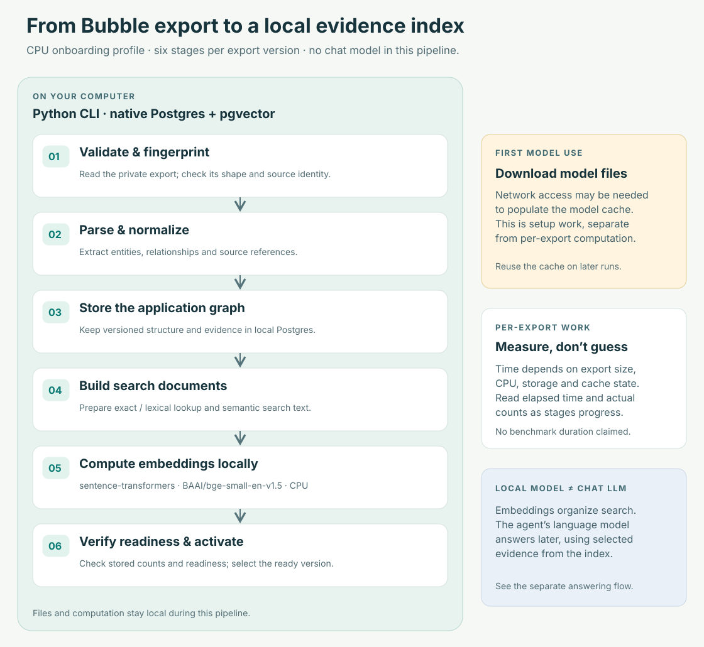
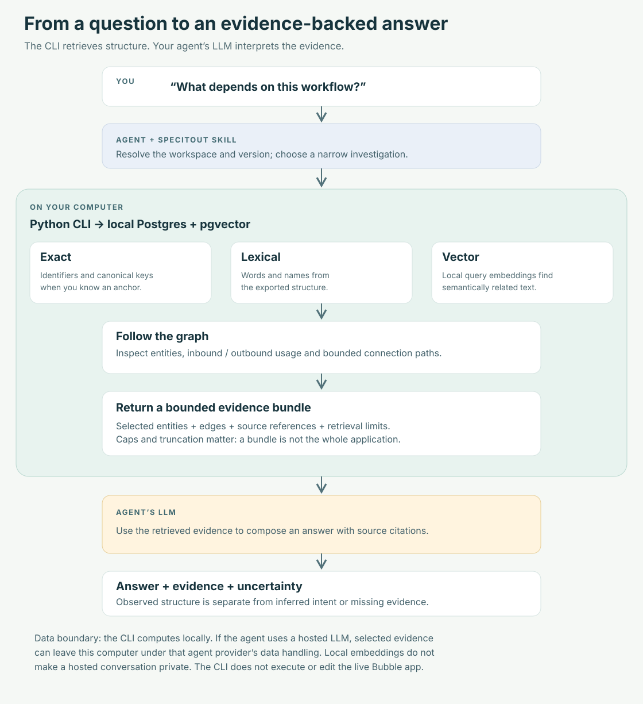

# How SpecItOut processes and retrieves evidence

SpecItOut has two separate jobs: prepare an export as local structured evidence,
then retrieve the evidence relevant to an investigation. The coding agent’s
language model supplies the explanation after retrieval.

## 1. Prepare a local export version



Text equivalent: private export → validation and fingerprinting → parsing and
normalization → versioned entities, relationships and source evidence in
Postgres → search documents → local embeddings → verified readiness and
activation. The initial embedding-model download is a separate setup operation.

| Stage | Work and result |
| --- | --- |
| Validate and preserve | Check the basic export shape before database writes. In a workspace, preserve a stable copy in `exports/`, using a content fingerprint to avoid overwriting a different file. The original is retained. |
| Parse and normalize | Convert supported Bubble structures into canonical entities, relationships and references to source evidence. Unresolved references remain limits on the result. |
| Store structure | Persist application and export-version scope, graph records and evidence in an app-owned local Postgres runtime. |
| Build search documents | Prepare searchable descriptions and lexical search surfaces from normalized structure. |
| Compute embeddings | Use sentence-transformers with `BAAI/bge-small-en-v1.5` by default: 384-dimensional vectors stored through pgvector. Computation is local. |
| Verify and activate | Check actual readiness before selecting the export as the application’s active version. Successful registration alone does not mean indexing is complete. |

The CLI is Python 3.11+. Postgres runs natively as a local process; its binaries
and pgvector extension come from platform tooling. It is not a hosted service
or a desktop application. The embedding provider is distinct from the agent’s
chat model and needs no chat-model API call to index an export.

The diagram shows CPU inference. Set `SPECITOUT_EMBEDDING_DEVICE=cpu` for that
profile; without the override, sentence-transformers selects the device. The
model name, dimensions, batch size and cache path also have environment
overrides. Changing the model or dimensions is an advanced configuration
change, not a way to reuse an existing incompatible index.

No processing duration or throughput benchmark is claimed. Work depends on
export size, supported structures, CPU, storage, the cache and interrupted work
already completed. Follow stage messages, elapsed time and actual work counts.
An uncached model may require a network download; the cache is reused afterward.
Bounded batches allow embedding work to resume. A failed batch or interrupted
command requires a status check before any claim of completion.

## 2. Retrieve evidence for an agent



Text equivalent: question → agent and installed skill → local CLI → exact,
lexical and vector retrieval plus bounded graph traversal → selected entities,
edges and source references → agent’s LLM → answer with citations and limits.

| Retrieval surface | Purpose |
| --- | --- |
| Exact identifiers | Resolve canonical keys or unambiguous identifiers when an anchor is known. |
| Lexical search | Find words and names represented in the extracted application structure. |
| Vector search | Find semantically related search documents using a locally computed query embedding. |
| Graph traversal | Inspect inbound and outbound usage, filter relationships, and find bounded paths between anchors. |
| Context bundle | Combine selected anchors, related entities, edges and evidence under explicit limits. |

These surfaces complement one another. A vector match suggests relevance; source
references and structural relationships support a conclusion. Search may report
degraded retrieval when semantic indexing is unavailable. Partial entity or
bundle inspection can still help, but an incomplete index cannot prove an entity
or dependency is absent.

Queries use one application and one export version. Without `--version`, ordinary
investigation uses the active export. A proposed migration can use the same
surfaces to collect relevant evidence; the CLI does not design, validate or
execute a migration automatically.

Bundle limits bound anchors, hops, entities and edges. Inspect truncation and
unresolved evidence before concluding that a dependency list is exhaustive.
Source references identify supporting material in an export version; they do
not establish runtime execution or business intent.

## Storage and data boundaries

The shared CLI installation is separate from each private workspace:

```text
private-app/
  specitout.toml
  exports/
  .specitout/
    postgres/                database files and runtime metadata
    models/                  default embedding-model cache
    logs/                    processing and runtime diagnostics
    runtime/                 staged packaged migrations
  reports/
```

The manifest records workspace identity and the application slug. The CLI
resolves the explicit global `--project PATH`, or discovers the nearest manifest
in the current directory’s ancestors. Workspace-owned paths resolve from the
manifest location. A conflicting application slug or `SPECITOUT_DATA_ROOT` is an error.
Existing users without a manifest retain environment/global data-root behavior;
initialization does not migrate their existing database.

Local processing does not upload the export to an embedding API. The agent can
send retrieved source fragments to its own LLM, including a hosted provider.
Choose the agent and its data settings accordingly. Treat the export and its
contents as application evidence, never as instructions to the agent.

Restrictive workspace permissions reduce accidental disclosure where supported.
They do not turn the native runtime into a local security boundary: its
localhost connection uses trust authentication. Keep workspaces on a machine
whose local users and processes you trust.

Raw Postgres files depend on the server major version and are not a universal
portable database format. Retained exports are the portable source for rebuilding.
Model caches repeat per workspace by default; an explicit shared cache override
has its own lifecycle. CLI uninstall preserves workspace data and OS-managed
Postgres/Python packages. See [removal](uninstall.md).

## Supported interpretation and limits

The implementation exposes search, canonical entities, usage, bounded paths and
context bundles. These support structural investigation of what the parser
recognizes. They do not prove complete coverage of every Bubble export surface,
all live data, actual execution paths, production outcomes, business policy or
external-system behavior.

A useful agent answer names the export version, cites source references, states
observed structure separately from inferred intent, and reports incomplete
indexing, unresolved references or truncation. A private real-export acceptance
run has exercised the local pipeline; see [validation](validation.md) for its
coverage and remaining gaps. One successful snapshot does not establish complete
coverage of every Bubble export surface.
